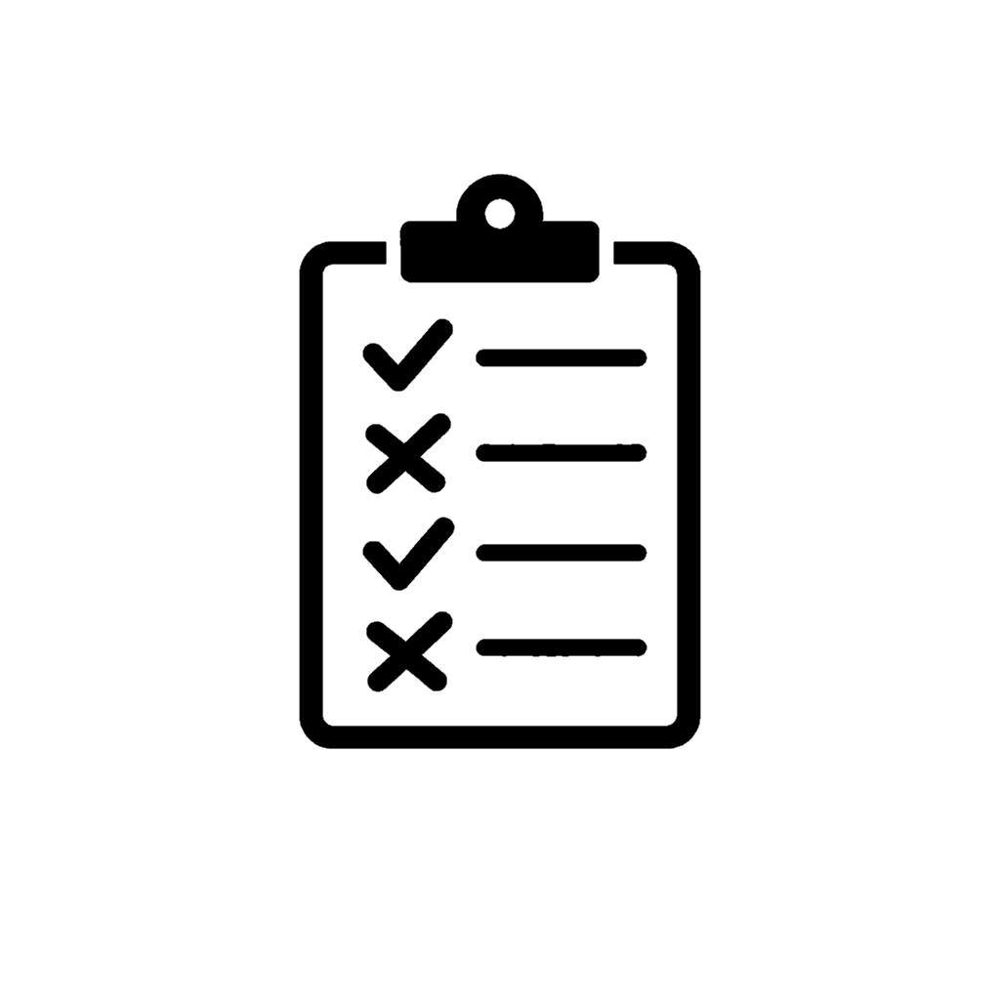

# Touchstone

Touchstone is a runner-agnostic test descriptor framework for .NET, distributed through NuGet. Define tests once, as plain descriptors or Given/When/Then behavior scenarios, and run them through the console runner (including native AOT), xUnit v2, xUnit v3, NUnit, or MSTest with native names, categories, and skips.

There is no Touchstone container image or Docker deployment. Install the packages from NuGet:

```bash
dotnet add package Touchstone.Core
dotnet add package Touchstone.Cli
dotnet add package Touchstone.Xunit3Adapter   # or Xunit2Adapter, NunitAdapter, MstestAdapter
```

Use cases: shared test suites that run locally in the console and in CI under `dotnet test`; integration and synthetic monitoring suites with tag filtering, JSON and HTML reports, and OpenTelemetry-shaped metrics and traces; behavior scenarios with typed context and guaranteed cleanup.

See the [repository README](https://github.com/jchristn/Touchstone/blob/main/README.md) for getting started, [BDD.md](https://github.com/jchristn/Touchstone/blob/main/BDD.md) for scenarios, [TELEMETRY.md](https://github.com/jchristn/Touchstone/blob/main/TELEMETRY.md) for metrics and traces, and [MIGRATION.md](https://github.com/jchristn/Touchstone/blob/main/MIGRATION.md) for upgrading from 0.3.0-alpha.
