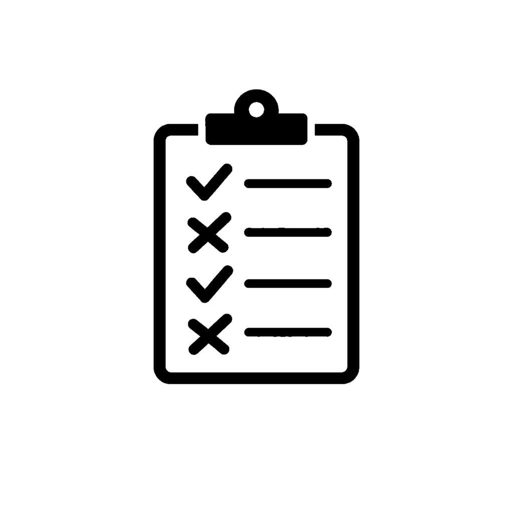

# Touchstone

Runner-agnostic test descriptor framework for .NET.

v1.0.0

## What is Touchstone?

Touchstone lets you write tests once, as plain descriptor objects in a shared library, and run them through any host: the built-in console runner for fast local feedback and native AOT, or xUnit (v2 or v3), NUnit, or MSTest for `dotnet test`, Test Explorer, and CI. Test logic never changes between hosts.

A test is a `TestCaseDescriptor`: an identity, a display name, optional tags and skip reason, and either an async delegate or a behavior scenario built from typed Given/When/Then steps. Both kinds run through the same engine, produce the same results, and report the same way in every host.

## Why Touchstone?

- **Write once, run anywhere.** The same descriptors run in the console, xUnit v2, xUnit v3, NUnit, MSTest, or a host you build.
- **Native behavior in every framework.** Each case is its own native test with its display name, its tags as traits or categories, and its skip reason as a native skip.
- **Consistent outcomes.** Passed, Failed, Skipped, Canceled, and NotRun mean the same thing everywhere, and how skipped cases are treated is configurable (report, omit, or fail).
- **Readable behavior scenarios.** Given/When/Then/And steps with a fresh context per execution, guaranteed cleanup, step-level results, and typed examples. See [BDD.md](BDD.md).
- **Filtering.** Select cases by tag, suite, or test identity from code, the command line, or native framework filters.
- **Predictable cancellation.** A canceled run stops cleanly, runs teardown, and reports what did not run.
- **Reports.** Tabular console output, JSON results with a published schema, and a self-contained offline HTML report.
- **Observability.** OpenTelemetry-shaped metrics and traces through the BCL `Meter` and `ActivitySource`, with no exporter dependency. See [TELEMETRY.md](TELEMETRY.md).
- **No lock-in.** Touchstone.Core has no third-party dependencies.

## Packages

| Package | Description |
|---|---|
| **Touchstone** | Metapackage: Touchstone.Core and Touchstone.Cli. Add the adapter for your test framework separately. |
| **Touchstone.Core** | Descriptors, behavior scenarios, the execution engine, filtering, and results. No third-party dependencies. AOT-compatible. |
| **Touchstone.Cli** | Console runner with command-line options, JSON results, offline HTML reports, and stable exit codes. AOT-compatible. |
| **Touchstone.Xunit2Adapter** | Run descriptors under xUnit 2.9.3 or later. |
| **Touchstone.Xunit3Adapter** | Run descriptors under xUnit v3 4.0.2 or later, with either test platform (Microsoft Testing Platform or VSTest). |
| **Touchstone.NunitAdapter** | Run descriptors under NUnit 5.0 or later. |
| **Touchstone.MstestAdapter** | Run descriptors under MSTest.TestFramework 4.4.1 or later. |

Upgrading from a 0.x prerelease? Read [MIGRATION.md](MIGRATION.md).

## Getting Started

### 1. Install packages

```bash
# Shared test library: no runner dependency
dotnet add package Touchstone.Core

# Console runner project
dotnet add package Touchstone.Cli

# One adapter per framework test project
dotnet add package Touchstone.Xunit3Adapter
dotnet add package Touchstone.Xunit2Adapter
dotnet add package Touchstone.NunitAdapter
dotnet add package Touchstone.MstestAdapter
```

### 2. Define tests in a shared library

Create a class library that references Touchstone.Core and the code under test. This walkthrough tests a small shopping cart. Put the class under test in `ShoppingCart.cs`, or reference your own code instead.

```csharp
namespace MyTests
{
    using System;

    /// <summary>A cart that tracks item count and total price.</summary>
    public sealed class ShoppingCart
    {
        /// <summary>Total price of the items added.</summary>
        public decimal Total { get; private set; }

        /// <summary>Number of items added.</summary>
        public int ItemCount { get; private set; }

        /// <summary>Add an item at the supplied price.</summary>
        /// <param name="price">Item price. Cannot be negative.</param>
        /// <exception cref="ArgumentOutOfRangeException">The price is negative.</exception>
        public void AddItem(decimal price)
        {
            if (price < 0m) throw new ArgumentOutOfRangeException(nameof(price));
            Total += price;
            ItemCount++;
        }
    }
}
```

Put the tests in `ShoppingCartSuites.cs`. The first case is a direct check. The second is a behavior scenario; its builder returns an ordinary descriptor. The third is skipped with a reason. The class implements `ITestSuiteProvider`, which the xUnit and MSTest adapters use to rebuild cases in the process that runs them.

```csharp
namespace MyTests
{
    using System;
    using System.Collections.Generic;
    using System.Threading.Tasks;

    using Touchstone.Core;

    /// <summary>Shared cart tests consumed by every host.</summary>
    public sealed class ShoppingCartSuites : ITestSuiteProvider
    {
        /// <summary>All suites, with fresh descriptors on each access.</summary>
        public static IReadOnlyList<TestSuiteDescriptor> All
        {
            get { return new[] { CartSuite() }; }
        }

        /// <inheritdoc />
        public IReadOnlyList<TestSuiteDescriptor> Suites
        {
            get { return All; }
        }

        /// <summary>Direct checks and behavior scenarios in one suite.</summary>
        /// <returns>The cart suite.</returns>
        public static TestSuiteDescriptor CartSuite()
        {
            return new TestSuiteDescriptor(
                suiteId: "Cart",
                displayName: "Shopping cart",
                cases: new[]
                {
                    new TestCaseDescriptor(
                        suiteId: "Cart",
                        caseId: "StartsEmpty",
                        displayName: "A new cart starts empty",
                        executeAsync: ct =>
                        {
                            ShoppingCart cart = new ShoppingCart();
                            if (cart.Total != 0m || cart.ItemCount != 0)
                                throw new InvalidOperationException("Expected an empty cart.");
                            return Task.CompletedTask;
                        },
                        tags: new[] { "fast" }),

                    new ScenarioBuilder<ShoppingCart>(
                        suiteId: "Cart",
                        caseId: "AddingAnItem",
                        displayName: "Adding an item increases the cart total",
                        createContextAsync: ct => Task.FromResult(new ShoppingCart()))
                        .WithTags(new[] { "fast", "bdd" })
                        .Given("existing", "the cart contains a $10 item", (cart, ct) =>
                        {
                            cart.AddItem(10m);
                            return Task.CompletedTask;
                        })
                        .When("add", "a $25 item is added", (cart, ct) =>
                        {
                            cart.AddItem(25m);
                            return Task.CompletedTask;
                        })
                        .Then("total", "the cart total is $35", (cart, ct) =>
                        {
                            if (cart.Total != 35m)
                                throw new InvalidOperationException("Expected total 35; received " + cart.Total + ".");
                            return Task.CompletedTask;
                        })
                        .And("count", "the cart contains two items", (cart, ct) =>
                        {
                            if (cart.ItemCount != 2)
                                throw new InvalidOperationException("Expected two items; received " + cart.ItemCount + ".");
                            return Task.CompletedTask;
                        })
                        .Build(),

                    new TestCaseDescriptor(
                        suiteId: "Cart",
                        caseId: "Discounts",
                        displayName: "Discount codes reduce the total",
                        executeAsync: ct => Task.CompletedTask,
                        skipReason: "Discount codes are not implemented"),
                });
        }
    }
}
```

Identities follow a simple grammar. A suite identity uses letters, digits, `_`, and `-`. A case identity also allows `.`. The test identity is `SuiteId.CaseId`, which is unique because suite identities cannot contain `.`. Duplicate case identities in a suite, and duplicate suite identities in a run, are rejected before anything runs.

Descriptors are immutable. Use `WithTags`, `WithSkip`, `WithoutSkip`, and `WithDisplayName` to derive changed copies; scenarios keep their steps.

### 3. Run in the console

Create a console application that references your shared library and Touchstone.Cli:

```csharp
namespace MyTests.Console
{
    using System.Threading.Tasks;

    using MyTests;
    using Touchstone.Cli;

    internal static class Program
    {
        private static Task<int> Main(string[] args)
        {
            return ConsoleRunner.RunMainAsync(ShoppingCartSuites.All, args);
        }
    }
}
```

`RunMainAsync` parses the command line, wires Ctrl+C to cancellation, and returns the exit code:

```bash
dotnet run                                  # run everything
dotnet run -- --tag fast                    # only cases tagged fast
dotnet run -- --exclude-tag slow --expand   # skip slow cases, show scenario steps live
dotnet run -- --skip fail                   # treat skipped cases as failures
dotnet run -- --results results.json --html report.html
dotnet run -- --help
```

| Option | Meaning |
|---|---|
| `--tag <tags>` | Run only cases with any of these tags. Repeatable and comma-separated. |
| `--exclude-tag <tags>` | Skip cases with any of these tags. Exclusion wins over inclusion. |
| `--suite <ids>` | Run only these suites. |
| `--test <ids>` | Run only these test identities (`SuiteId.CaseId`). |
| `--skip report\|omit\|fail` | How to treat skipped cases. Default `report`. |
| `--stop-on-failure` | Stop at the first failed case; the rest are reported as not run. |
| `--results <path>` | Write JSON results. |
| `--html <path>` | Write an offline HTML report. |
| `--expand` | Show scenario steps as they run. |
| `--no-color` | Disable color. |

| Exit code | Meaning |
|---|---|
| 0 | Every selected case passed or was skipped, and no suite hook failed. |
| 1 | A case failed or was not run, or a suite hook failed. |
| 2 | The run was canceled. |
| 3 | The arguments were invalid. No test ran. |

To configure the runner in code instead, pass a `ConsoleRunnerOptions` to `ConsoleRunner.RunAsync`. Its `Run` property is a `TestRunOptions`, and `AdditionalSinks` receives every event alongside the console.

Output for the walkthrough suite (timings are illustrative):

```text
Test                                              Result      Runtime
------------------------------------------------  --------  ---------
A new cart starts empty                           PASS            1ms
Adding an item increases the cart total           PASS            2ms
Discount codes reduce the total                   SKIP            0ms

OVERALL                                           PASS            3ms
Total: 3  Passed: 2  Failed: 0  Skipped: 1
```

### 4. Run with xUnit v3

Reference Touchstone.Xunit3Adapter, `xunit.v3` (or `xunit.v3.mtp-off` for VSTest), and your shared library. Each case becomes a theory row with its display name, its tags as `Category` traits, and its skip reason as a native skip:

```csharp
namespace MyTests.Xunit3
{
    using System.Threading.Tasks;

    using MyTests;
    using Touchstone.Xunit3Adapter;
    using Xunit;

    public sealed class CartTests
    {
        public static TheoryData<TouchstoneXunit3Case> Cases()
        {
            return TouchstoneXunit3Cases.From<ShoppingCartSuites>();
        }

        [Theory]
        [MemberData(nameof(Cases))]
        public Task Run(TouchstoneXunit3Case testCase)
        {
            return TouchstoneXunit3.ExecuteAsync(testCase, TestContext.Current.CancellationToken);
        }
    }
}
```

`dotnet test --filter "Category=fast"` selects tagged cases natively.

### 5. Run with xUnit v2

```csharp
namespace MyTests.Xunit2
{
    using System.Threading.Tasks;

    using MyTests;
    using Touchstone.Xunit2Adapter;
    using Xunit;
    using Xunit.Abstractions;

    public sealed class CartTests
    {
        private readonly ITestOutputHelper _Output;

        public CartTests(ITestOutputHelper output)
        {
            _Output = output;
        }

        public static TheoryData<TouchstoneXunit2Case> Cases()
        {
            return TouchstoneXunit2Cases.From<ShoppingCartSuites>();
        }

        [Theory]
        [MemberData(nameof(Cases))]
        public Task Run(TouchstoneXunit2Case testCase)
        {
            return TouchstoneXunit2.ExecuteAsync(testCase, _Output);
        }
    }
}
```

xUnit v2 cannot skip a theory row at run time or attach per-row traits. With the default skip behavior, a skipped case passes and writes its skip reason to the test output. Use xUnit v3 for native skips.

### 6. Run with NUnit

```csharp
namespace MyTests.Nunit
{
    using System.Collections.Generic;
    using System.Threading.Tasks;

    using MyTests;
    using NUnit.Framework;
    using Touchstone.Core;
    using Touchstone.NunitAdapter;

    public sealed class CartTests
    {
        public static IEnumerable<TestCaseData> Cases()
        {
            return TouchstoneNunitCases.From(ShoppingCartSuites.All);
        }

        [TestCaseSource(nameof(Cases))]
        public Task Run(TestCaseDescriptor testCase)
        {
            return TouchstoneNunit.ExecuteAsync(testCase, null, null, TestContext.CurrentContext.CancellationToken);
        }
    }
}
```

Each case becomes an NUnit test named by its display name, with its tags as categories and its skip reason as a native ignore. `dotnet test --filter "TestCategory=fast"` works.

### 7. Run with MSTest

```csharp
namespace MyTests.Mstest
{
    using System.Collections.Generic;
    using System.Threading.Tasks;

    using Microsoft.VisualStudio.TestTools.UnitTesting;
    using MyTests;
    using Touchstone.MstestAdapter;

    [TestClass]
    public sealed class CartTests
    {
        public TestContext TestContext { get; set; } = null!;

        public static IEnumerable<TestDataRow<TouchstoneMstestCase>> Cases()
        {
            return TouchstoneMstestCases.From<ShoppingCartSuites>();
        }

        [TestMethod]
        [DynamicData(nameof(Cases))]
        public Task Run(TouchstoneMstestCase testCase)
        {
            return TouchstoneMstest.ExecuteAsync(testCase, TestContext, TestContext.CancellationToken);
        }
    }
}
```

Each case becomes a data row with its display name, its tags as test categories, and its skip reason as a native ignore.

### Running everything in one framework test

Every adapter also has a run-all base class (`TouchstoneXunit3FactBase`, `TouchstoneXunit2FactBase`, `TouchstoneNunitFactBase`, `TouchstoneMstestFactBase`). It runs the suites with their setup and teardown hooks and throws one `AggregateException` whose inner exceptions are the original failures:

```csharp
namespace MyTests.Nunit
{
    using System.Collections.Generic;
    using System.Threading.Tasks;

    using MyTests;
    using NUnit.Framework;
    using Touchstone.Core;
    using Touchstone.NunitAdapter;

    public sealed class CartRunAll : TouchstoneNunitFactBase
    {
        protected override IReadOnlyList<TestSuiteDescriptor> Suites
        {
            get { return ShoppingCartSuites.All; }
        }

        [Test]
        public Task RunAll()
        {
            return RunAllAsync(TestContext.CurrentContext.CancellationToken);
        }
    }
}
```

Suite hooks (`beforeSuiteAsync` and `afterSuiteAsync`) run in the console runner and the run-all base classes. One-row-per-case hosts run cases individually, so they do not run suite hooks; keep per-case setup inside the case or scenario context.

## Outcomes

| Outcome | Meaning |
|---|---|
| Passed | The case ran without an exception. |
| Failed | The case threw, its suite setup failed, its scenario cleanup failed, or it was skipped under `SkipBehavior.Fail`. |
| Skipped | The case has a skip reason and did not run. |
| Canceled | The case observed caller cancellation. |
| NotRun | The case was selected but never started, because the run was canceled or stopped on a failure. |

Filtered cases (excluded by the filter or by `SkipBehavior.Omit`) produce no result and are counted in `TestRunSummary.Filtered`.

## Filtering

`TestRunOptions.Filter` selects cases by tag, suite, and test identity. Tags compare case-insensitively; exclusion wins over inclusion; criteria combine with AND. The adapters apply the filter when they create rows, and the console runner exposes it through `--tag`, `--exclude-tag`, `--suite`, and `--test`.

```csharp
namespace MyTests.Console
{
    using System.Threading.Tasks;

    using MyTests;
    using Touchstone.Core;

    internal static class FilteredRun
    {
        internal static async Task<TestRunSummary> RunFastCasesAsync()
        {
            TestRunOptions options = new TestRunOptions();
            options.Filter.IncludeTags.Add("fast");
            options.Filter.ExcludeTags.Add("flaky");
            return await TestExecutor.RunAsync(ShoppingCartSuites.All, null, options).ConfigureAwait(false);
        }
    }
}
```

## Skip behavior

`TestRunOptions.SkipBehavior` decides what a skip reason means for a run:

| Value | Console and engine | Framework adapters |
|---|---|---|
| `Report` (default) | Reported as Skipped. | Native skip: xUnit v3 row skip, NUnit ignore, MSTest ignore. xUnit v2 passes and writes the reason to output. |
| `Omit` | Not run, not reported, counted as filtered. | No row is created. |
| `Fail` | Reported as Failed with `SkippedCaseNotAllowedException`. | The row fails. |

`Fail` is useful in CI to catch skips that were meant to be temporary.

## Cancellation

When the caller cancels a run, the case in progress finishes or observes the cancellation (and is reported as Canceled), the current suite's teardown runs, and every remaining selected case is reported as NotRun. `TestExecutor.RunAsync` returns normally with `TestRunSummary.WasCanceled` set; it does not throw. Teardown gets its own token, which is canceled only after `TestRunOptions.CleanupTimeout` (default 30 seconds) once the caller cancels. Single-case entry points that throw (`ExecuteCaseAsync`, the adapter helpers, and the run-all base classes) throw `OperationCanceledException`.

A case counts as Canceled when it throws `OperationCanceledException` while the caller's token is canceled. The same exception with an uncanceled caller token (for example an internal timeout) is a failure.

## Results and reports

- `TestResultCollector` keeps results in memory. Any `ITestResultSink` receives run, suite, case, and step events; every sink member has a default implementation, so implement only what you need.
- `JsonReport.WriteAsync` writes results that follow [schemas/touchstone-results-1.0.schema.json](schemas/touchstone-results-1.0.schema.json), which also ships in the Touchstone.Cli package and is available as `JsonReport.Schema`.
- `HtmlReport.WriteAsync` writes a self-contained, accessible report with no scripts or remote resources.
- `ReportOptions.Redact` and `ConsoleRunnerOptions.Redact` transform every consumer-supplied string before it is written.

## Telemetry

Touchstone emits metrics and traces on a `Meter` and an `ActivitySource`, both named `Touchstone`. Nothing leaves the process unless the host subscribes, for example with the OpenTelemetry SDK. Span names are fixed (`touchstone.run`, `touchstone.suite`, `touchstone.case`, and so on), identities are attributes, and metric labels are bounded. The case span is current while a case runs, so outbound HTTP calls carry its W3C `traceparent`. [TELEMETRY.md](TELEMETRY.md) has the full catalog, configuration, alerts, and dashboards.

## AOT support

**Touchstone.Core and Touchstone.Cli: Supported.** Both are marked `IsAotCompatible` and publish under native AOT with no trim or AOT warnings. JSON export uses source-generated serialization. `src/Test.Aot` runs the shared contract suites as a native binary on Linux, Windows, and macOS in CI.

**Framework adapters: Not applicable.** xUnit, NUnit, and MSTest discover and run tests through reflection, so the adapters run where those frameworks run.

Test.Aot runs every suite in `Test.Shared` except the reflection-based API convention suites in `Test.Shared.Reflection` (catalog rows API-01 to API-12, suites `ApiCore` and `ApiCli`). Those checks inspect assembly metadata and XML documentation files, which do not exist in a trimmed native binary. Every JIT host runs them.

## Support policy

- Touchstone follows [Semantic Versioning](https://semver.org) from 1.0.0. Within a major version, public APIs, the JSON results schema, console exit codes, and telemetry names change only additively.
- Target frameworks: .NET 8 and .NET 10.
- Framework adapters: xUnit 2.9.3+, xUnit v3 4.0.2+, NUnit 5.0+, MSTest.TestFramework 4.4.1+.

## What Touchstone is not

- Not an assertion library. Throw any exception to fail a case, or use the assertions you already have.
- Not a reflection-based discovery framework. Suites are plain objects you construct.
- Not a parallel runner. Cases run in order within a run; framework hosts may run test classes in parallel as they normally do.
- Not a Gherkin parser. Scenarios are written in C#.

## Sample app

`src/Touchstone.SampleApp` is a small Notes API. `test/Touchstone.SampleApp.Tests.*` run the same shared suites (direct HTTP checks and behavior scenarios) through the console and all four frameworks:

```bash
dotnet run --project test/Touchstone.SampleApp.Tests.Console
dotnet run --project test/Touchstone.SampleApp.Tests.Console -- --tag smoke
dotnet run --project test/Touchstone.SampleApp.Tests.Console -- --expand --html notes.html
dotnet test test/Touchstone.SampleApp.Tests.Xunit3
dotnet test test/Touchstone.SampleApp.Tests.Xunit2
dotnet test test/Touchstone.SampleApp.Tests.Nunit
dotnet test test/Touchstone.SampleApp.Tests.Mstest
```

## Testing Touchstone

Touchstone tests itself with its own descriptors. Every case identity is a row in the test catalog ([archive/V1.0_PLAN.md](archive/V1.0_PLAN.md), section 11), and `scripts/verify-catalog.py` fails CI when a catalog row has no passing case.

| Project or script | Purpose |
|---|---|
| `src/Test.Shared` | Runner-agnostic contract suites for Core and Cli. References only Core and Cli. |
| `src/Test.Shared.Reflection` | API convention checks (JIT hosts only). |
| `src/Test.Shared.{Xunit2,Xunit3,Nunit,Mstest}` | Adapter contract suites, generated from one shared contract per adapter. |
| `src/Test.Automated` | Console host (net8.0 and net10.0). |
| `src/Test.Aot` | Native AOT host. Published and run by `scripts/verify-hosts.py`. |
| `src/Test.{Xunit2,Xunit3,Nunit,Mstest}` | Native hosts: one test per case, plus a run-all test. |
| `test/Parity` | Deliberately mixed fixtures; `scripts/verify-parity.py` compares native outcomes across adapters. |
| `test/Consumer.Smoke` | Package consumers; `scripts/smoke-packages.py` packs to a local feed and runs them. |

```bash
dotnet build Touchstone.slnx -c Release
dotnet run --project src/Test.Automated -c Release -f net10.0
dotnet test Touchstone.slnx -c Release
python3 scripts/verify-hosts.py --rid osx-arm64
python3 scripts/verify-parity.py
python3 scripts/smoke-packages.py
python3 scripts/verify-docs.py
```

The [benchmark harness](BENCHMARKING.md) measures delegate and scenario execution overhead; [recorded results](benchmarks/RESULTS.md) include methodology and limitations.

## Version history

Refer to [CHANGELOG.md](CHANGELOG.md).

## Issues and feedback

Open an issue at https://github.com/jchristn/touchstone/issues.

## License

Touchstone is available under the MIT license. Refer to [LICENSE.md](LICENSE.md) for the full text.
